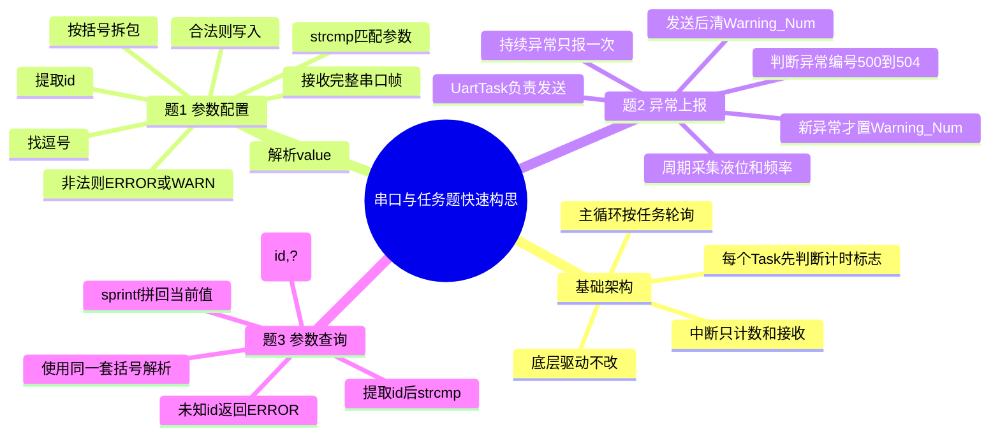

# 三道题编码思维导图

## 总体思维导图



## 考场通用开发顺序

1. 先列全局变量：参数值、测量值、界面状态、告警编号、计数器。
2. 主循环只调用任务：`SmgTask()`、`KbtTask()`、`SonicTask()`、`Ne555Task()`、`UartTask()`。
3. 中断里不要写复杂逻辑，只做扫描、计数、接收、定时。
4. 每个任务开头写节拍判断，例如 `if(uart_cnt <= 500) return;`。
5. 串口题统一放在 `UartTask()`，避免分散到底层 UART 文件。

## 题1：参数配置

目标是处理 `(H1,2.0)(H2,0.3)(r,1.2)` 这种不定长输入。最稳的写法不是直接 `sscanf`，而是手动扫描。

编码流程：先确认第一个字符是 `(`，再向后找 `)`；扫描过程中记录唯一的 `,`；逗号前拷贝到 `id[]` 并补 `\0`；逗号后逐字符解析数字；最后用 `strcmp(id,"H1")`、`strcmp(id,"S")` 判断写哪个参数。

返回规则：参数名不存在返回 `ERROR`；参数名存在但取值范围不合法，本帧其他合法参数仍可生效，最后返回 `WARN`；全部合法返回 `OK`。

常见坑：`id[]` 不补 `\0` 不能用于 `strcmp`；多包连续输入时，处理完一个 `)` 后要让 `start = end + 1`；`S` 是枚举，只允许 `0/1/2`。

## 题2：异常上报

异常上报分两步：检测异常和发送异常。检测放在 `FreqWarnTask()`，发送放在 `UartTask()`，这样不会在检测函数里直接占用串口。

异常编号建议固定映射：`500` 表示高于液位上限，`501` 表示低于液位下限，`502` 表示频率超限，`503` 表示频率连续趋势异常，`504` 表示频率突变。

核心逻辑：每次先算 `current_warning`；如果它和 `Warning_Last` 不同，说明是新异常，才令 `Warning_Num = current_warning`；如果相同，说明异常持续，不再重复上报。`UartTask()` 发现 `Warning_Num` 后用 `sprintf` 组帧，例如 `[501,220856,1.00]`，发送后清零。

常见坑：`Warning_Num` 要能存 `500~504`，不能用 8 位 `unsigned char`；发送后必须 `Warning_Num = 0`；恢复判断要加一点回差，例如低液位恢复用 `h > H2 + 0.05`，避免临界值抖动重复触发。

## 题3：参数查询

查询不要另写一套解析器，直接复用题1的括号、逗号、id 提取流程。推荐格式是 `(H1,?)`、`(F,?)`、`(S,?)`。

编码流程：解析出 `id` 和逗号后的内容后，先判断 `value_len == 1 && uart_buffer[value_start] == '?'`。成立则进入查询分支，用 `strcmp` 匹配参数并 `sprintf` 返回当前值，例如 `(H1,1.00)`。如果不是 `?`，继续走原来的数值解析和参数设置。

这样做的好处是结构统一：设置和查询都走同一套“找括号、找逗号、取 id”的流程，代码更少，也不会出现查询分支永远执行不到的问题。

## 快速编码模板

```c
while(start < uart_pos)
{
    check '(';
    find ')' and ',';
    copy id and add '\0';

    if(value is '?')
    {
        query by strcmp(id, ...);
        send current value;
        return;
    }

    parse number manually;
    set parameter by strcmp(id, ...);
    start = end + 1;
}

send has_warn ? "WARN" : "OK";
```

## 理解口诀

串口解析先定界，左括号进、右括号出；逗号前是名字，逗号后是值；名字必须补零再 `strcmp`；设置看范围，查询看问号；异常先检测编号，串口任务再统一发送；持续异常锁住编号，恢复后才允许再次上报。
